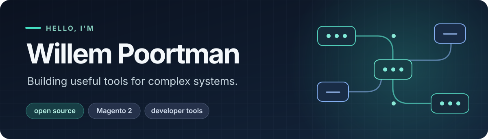

I started out in carpentry. The materials changed, but I still love making things people can build on.

I'm **Willem**, a self-taught developer and solutions architect from the Netherlands. I've worked agency-side as a Magento developer, architect, and technical director. Then, over five years at Hyvä, I architected and built **Hyvä Checkout** from the ground up. I also created **Magewire**, an open-source framework for building reactive Magento interfaces in PHP.

The thread through it all is making ambitious ideas usable for the next developer: clear foundations, thoughtful APIs, and software tested against real projects.

## Work I'm proud of

### Hyvä Checkout

Checkout grew into a flexible product used by merchants around the world. Its real-world integrations, performance demands, and upgrade paths also became a proving ground for Magewire 3.

[Explore Hyvä Checkout →](https://docs.hyva.io/hyva-checkout/) · [Read the story →](https://www.linkedin.com/pulse/closing-one-chapter-building-next-willem-poortman-dhfte)

### Magewire

I started Magewire in 2021 to make dynamic Magento interfaces possible without a heavy JavaScript architecture. What began as a Livewire-inspired experiment now powers production experiences including Hyvä Checkout. Magewire 3 is the result of years of building, testing, and rethinking the details with real projects.

[Source code →](https://github.com/magewirephp/magewire) · [Documentation →](https://docs.magewirephp.nl/)

## More things I've made

- [Magehook](https://github.com/wpoortman/magehook) — a webhook abstraction for Magento 2.
- [Stacktrace](https://github.com/wpoortman/stacktrace) — a local-first macOS work journal for showing progress, not hours.

## Thinking in public

I write about the decisions behind the code and share what I learn with the Magento community. A few places to start: [Magewire 3: Getting It Right](https://www.linkedin.com/pulse/magewire-3-getting-right-willem-poortman-drlxe/) and [my MageTitans talk](https://magetitans.nl/archive/2024).

## What's next

After five years at Hyvä, I'm exploring new ideas and opportunities while continuing to build Magewire. If you're working on an ambitious product, wrestling with architecture, or just want to compare notes over coffee, [let's connect](https://www.linkedin.com/in/wpoortman/).
